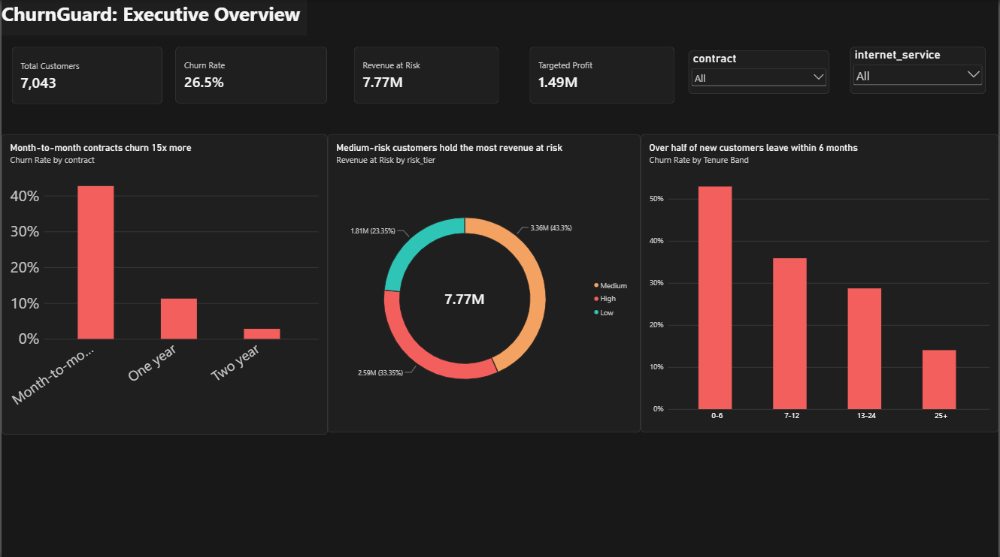
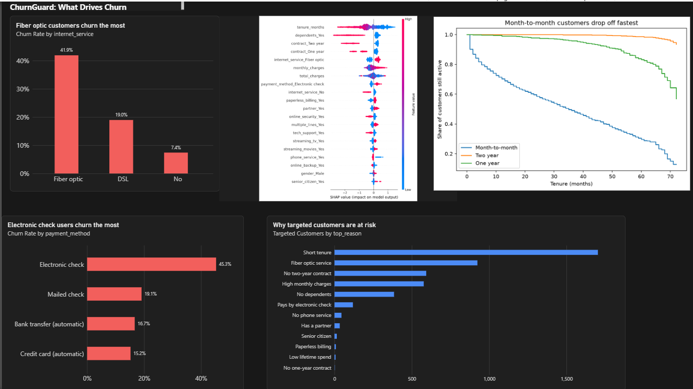
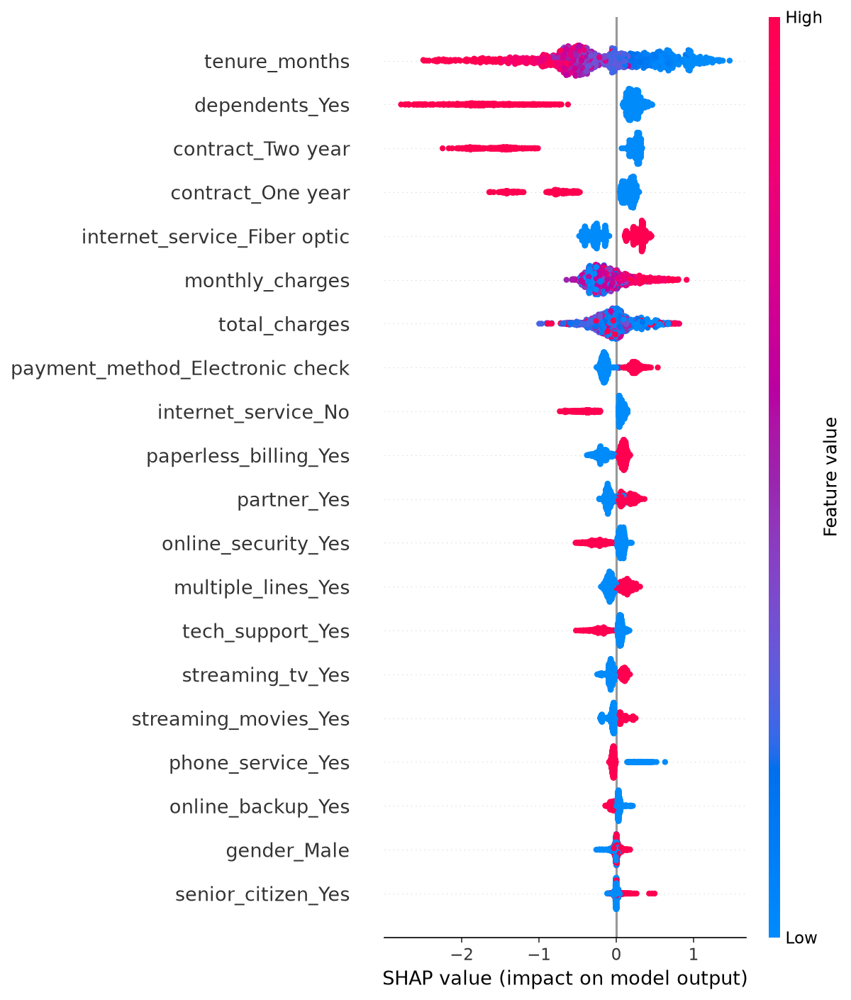
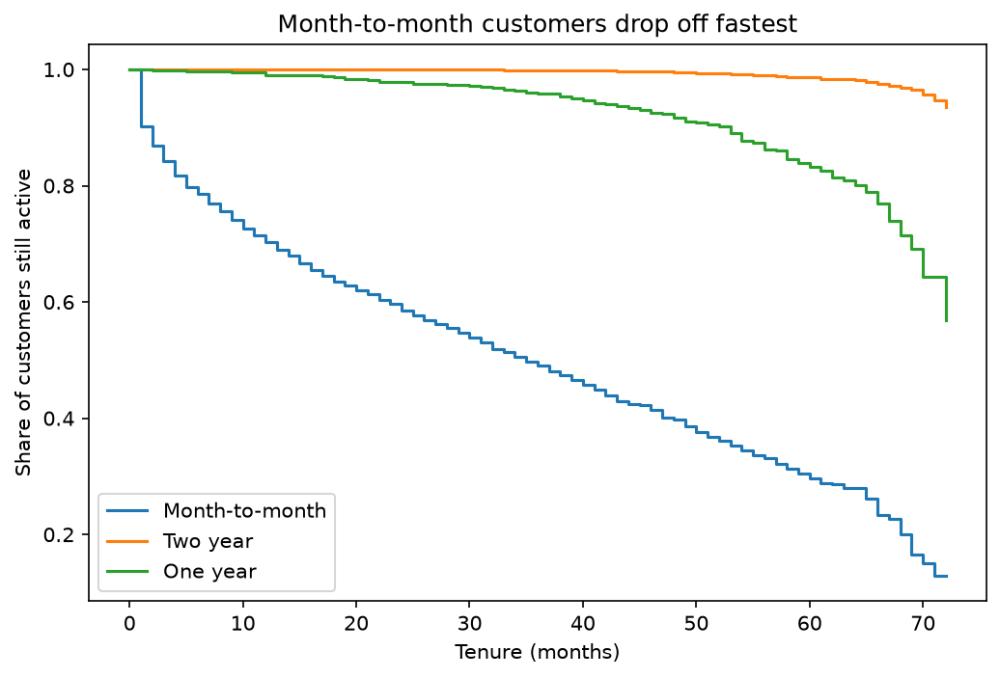
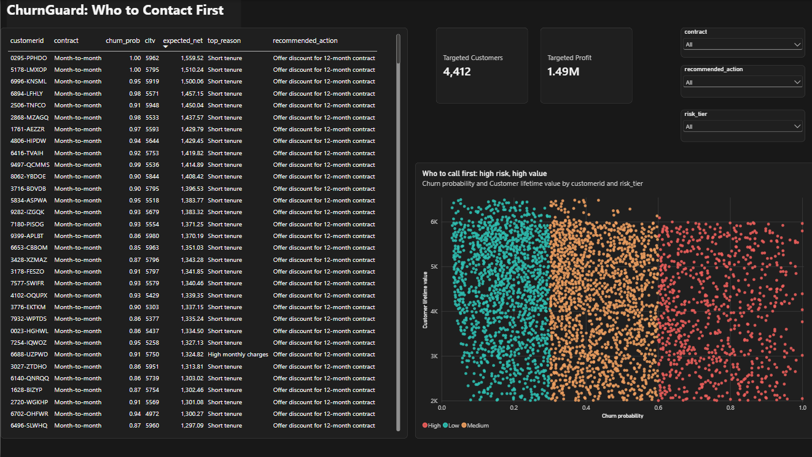
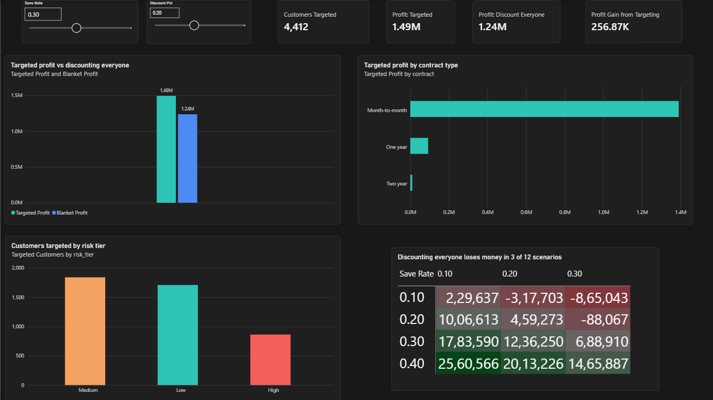

# ChurnGuard: Retention Targeting Engine

**Offering a discount to only the 4,412 customers most worth saving earns $1.49M, against $1.24M for discounting everyone: a $256.87K (21%) gain.**



Python (XGBoost, SHAP, survival analysis) for the modelling, SQL for the KPIs, Power BI for the dashboard. Walkthrough video: *coming soon*.

---

## Churn puts $7.77M at risk, concentrated in new month-to-month customers

26.5% of the 7,043 customers in this telecom dataset have churned, which puts **$7.77M of lifetime value at risk**. The obvious fix is a blanket discount, but that gives money to customers who would have stayed anyway.

The question this project answers: **who should we contact first, with what offer, and does it pay off?**

## Contract, tenure and payment method explain who leaves

- **Month-to-month contracts churn at 42.7%, against 2.8% for two-year contracts.**
- **52.9% of customers leave within their first 6 months.** After 24 months the rate falls to 14%.
- Fiber optic customers churn at 41.9% (DSL: 19.0%). Electronic check users churn at 45.3%, against 15-19% for every other payment method.
- Survival analysis shows month-to-month customers dropping off fastest: roughly half are gone by month 40, while about 94% of two-year customers are still active at month 72. A Cox model (concordance 0.86) agrees.
- SHAP ranks **tenure, dependents and contract type** as the top drivers of each prediction.



| SHAP: what drives each prediction | Survival: who stays longest |
|---|---|
|  |  |

*These are associations in the model, not proof of cause.*

## Medium-risk customers hold the most revenue at risk, but 863 high-risk customers hold a third of it

| Risk tier | Share of revenue at risk |
|---|---|
| Medium | 43.3% |
| High (863 customers, 12% of the base) | 33.4% |
| Low | 23.3% |

The model scores every customer's churn probability and expected value. Each customer on the action list gets a recommended action and the main reason they are at risk, for example *"Offer discount for 12-month contract, because of short tenure."* The list is sorted by expected net value, so the retention team starts at the top.



## Targeting 4,412 customers beats discounting everyone by 21%

A customer is targeted only when the expected saving exceeds the cost of the offer:

```
churn probability x save rate x customer lifetime value  >  offer cost
```



At a 30% save rate and a 20% discount for 12 months:

| Strategy | Profit |
|---|---|
| Discount only the 4,412 targeted customers | **$1.49M** |
| Discount everyone | $1.24M |
| Gain from targeting | **$256.87K (+21%)** |

- 3,553 of the 4,412 targeted customers are on month-to-month contracts, and they produce $1.39M of the $1.49M.
- Across 12 save-rate and discount scenarios, targeting stayed profitable in all of them. **Discounting everyone lost money in 3 of the 12.**
- The what-if page has sliders for both assumptions so you can test your own.

## What I would do with this

1. **Target the 4,412, not everyone.** Blanket discounts only pay when the save rate is high.
2. **Offer 12-month contract discounts to month-to-month customers in their first 6 months.** That is where churn and profit are concentrated.
3. **A/B test the real save rate before rolling out.** It is the most important number here and it is assumed, not measured.

---

## How it works

| Step | What happens | Where |
|---|---|---|
| Clean and explore | IBM Telco data, 7,043 customers; fix blank `total_charges`, find the main churn patterns | `notebooks/01_eda.ipynb` |
| Predict churn | Logistic regression baseline, then XGBoost with calibrated probabilities | `notebooks/02_models.ipynb` |
| Explain | SHAP for the drivers, Kaplan-Meier curves and a Cox model for time to churn | `notebooks/03_explain_survival.ipynb` |
| Target | Expected net value per customer, recommended action, sensitivity across 12 scenarios | `notebooks/04_targeting.ipynb` |
| Query | Predictions loaded into SQLite and queried with 10 KPI queries | `sql/kpi_queries.sql` |
| Present | 4-page Power BI dashboard (Executive, Drivers, What-if, Action list) | `powerbi/churnguard.pbix` |

**Model quality** (20% held-out test set, stratified split):

| Model | ROC-AUC | PR-AUC |
|---|---|---|
| Logistic regression | 0.849 | 0.644 |
| XGBoost | 0.853 | 0.666 |
| XGBoost, calibrated (used downstream) | 0.856 | n/a |

- Calibration lowered the Brier score from 0.1341 to 0.1326, and the calibration curve tracks the diagonal, so the probabilities can be used directly in profit calculations.
- At the default 0.5 threshold the model catches about 54% of churners. That is why targeting is decided by expected profit instead of a fixed threshold.
- `churn_score`, `churn_label` and `churn_reason` are excluded from the features. They describe the outcome and would leak the answer.
- The profit figures use out-of-fold predictions, so each customer is scored by a model that never saw them.

## Run it yourself

1. Download **Telco customer churn: IBM dataset** from Kaggle (uploaded by TanKY) and place `Telco_customer_churn.xlsx` in `data/raw/`.
2. Create an environment and install the libraries:
   ```
   python -m venv .venv
   .venv\Scripts\activate        # Windows
   pip install -r requirements.txt
   ```
3. Run the notebooks in `notebooks/` in order, `01` to `04`. They create the cleaned data, the figures, the model and `data/outputs/predictions.csv`.
4. Open `powerbi/churnguard.pbix` in [Power BI Desktop](https://powerbi.microsoft.com/desktop/) (free, Windows). If the data source path breaks, repoint it under **Transform data > Data source settings** to your `data/outputs/` folder.

## Repository

```
data/
  raw/          original dataset (not included, see above)
  processed/    cleaned data
  outputs/      predictions.csv, sensitivity.csv, churnguard.db
notebooks/      01 to 04, run in order
sql/            KPI queries
models/         trained model (regenerated by running notebook 02)
reports/
  figures/      SHAP, survival and calibration plots
  dashboard/    dashboard page screenshots
powerbi/        churnguard.pbix
```

## Caveats and next steps

- **The save rate (30%) and discount (20% for 12 months) are assumptions**, not measured from this data. That is why the what-if page exists.
- The data is a public sample from a fictional telecom company and a single snapshot, so there is no time dimension. With dated data, the next step is retraining on a schedule and feeding retention outcomes back in to catch drift.
- The model finds who is likely to churn, not who will respond to an offer. Uplift modelling on real campaign data would address that.
- The Cox concordance (0.86) is measured on the same data the model was fit on, so it is slightly optimistic.
- Next: score customers 30 days before renewal and track which offers actually work.
